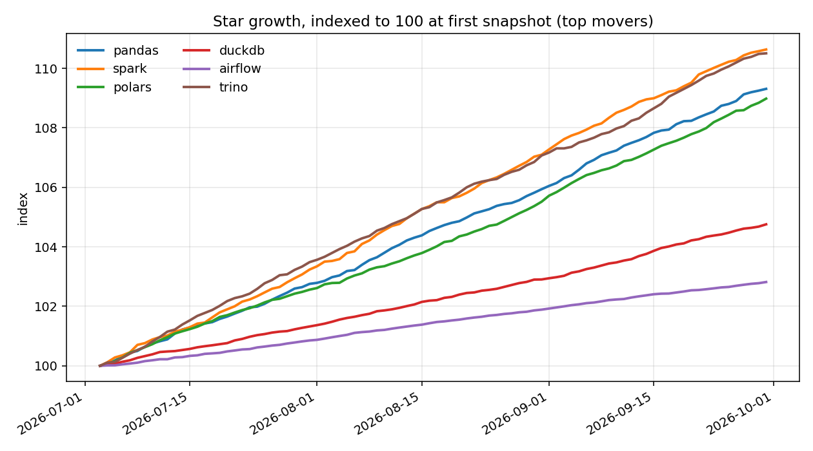
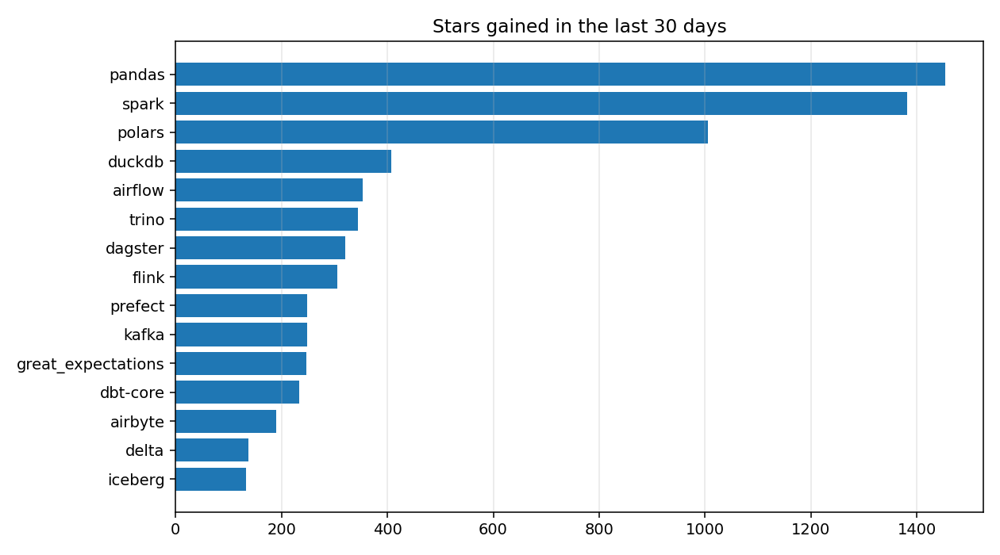

# Data tooling tracker (SYNTHETIC DEMO DATA)

Snapshots: **90** days (2026-07-03 to 2026-09-30), **15** repositories.

## Leaderboard

| repo | category | stars_now | gain_7d | gain_30d | pct_30d | momentum | issues_per_1k_stars | days_since_push | days_since_release |
|---|---|---|---|---|---|---|---|---|---|
| pandas-dev/pandas | processing | 47061 | 328 | 1453 | 3.19 | 0.97 | 27.6 | 0 | 40 |
| apache/spark | processing | 43214 | 242 | 1382 | 3.3 | 0.75 | 29.4 | 0 | 11 |
| pola-rs/polars | processing | 31627 | 230 | 1006 | 3.29 | 0.98 | 29.3 | 0 | 33 |
| duckdb/duckdb | processing | 23057 | 83 | 408 | 1.8 | 0.87 | 31.1 | 0 | 8 |
| apache/airflow | orchestration | 39088 | 81 | 353 | 0.91 | 0.98 | 30.5 | 0 | 34 |
| trinodb/trino | processing | 11065 | 68 | 344 | 3.21 | 0.85 | 33.9 | 0 | 8 |
| dagster-io/dagster | orchestration | 11983 | 72 | 321 | 2.75 | 0.96 | 29.5 | 0 | 28 |
| apache/flink | processing | 24955 | 66 | 306 | 1.24 | 0.92 | 33.1 | 0 | 34 |
| PrefectHQ/prefect | orchestration | 16683 | 58 | 248 | 1.51 | 1 | 35.2 | 0 | 5 |
| apache/kafka | ingestion | 28741 | 47 | 248 | 0.87 | 0.81 | 30.6 | 0 | 30 |
| great-expectations/great_expectations | data quality | 10730 | 53 | 247 | 2.36 | 0.92 | 32.1 | 0 | 30 |
| dbt-labs/dbt-core | transformation | 10164 | 64 | 233 | 2.35 | 1.18 | 34.2 | 0 | 8 |
| airbytehq/airbyte | ingestion | 15578 | 33 | 190 | 1.23 | 0.74 | 32.2 | 0 | 15 |
| delta-io/delta | storage | 7353 | 35 | 137 | 1.9 | 1.09 | 31.1 | 0 | 24 |
| apache/iceberg | storage | 6336 | 30 | 133 | 2.14 | 0.97 | 34.6 | 0 | 4 |

*momentum = 7-day daily star rate / 30-day daily star rate (above 1 means accelerating). Blank growth cells mean the history is shorter than the window.*

## Headline

- Fastest grower over 30 days: **pandas-dev/pandas** (+1,453 stars, 3.19%).
- Most active category by 30-day star gain: **processing** (+4,899).
